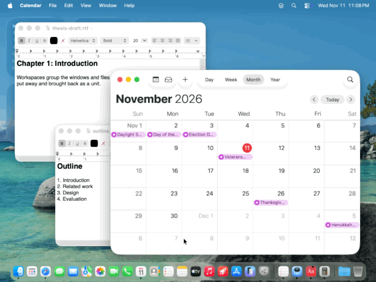
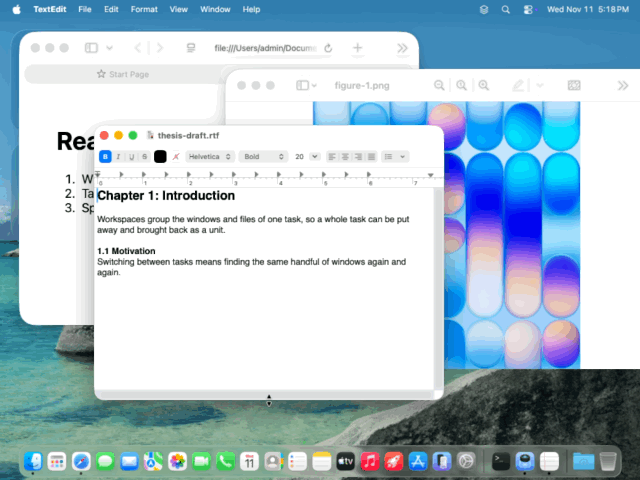
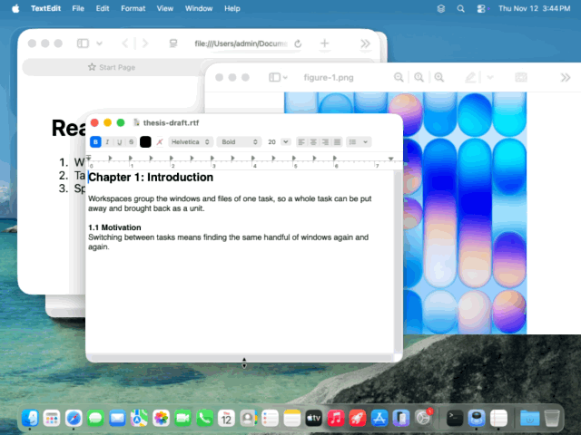
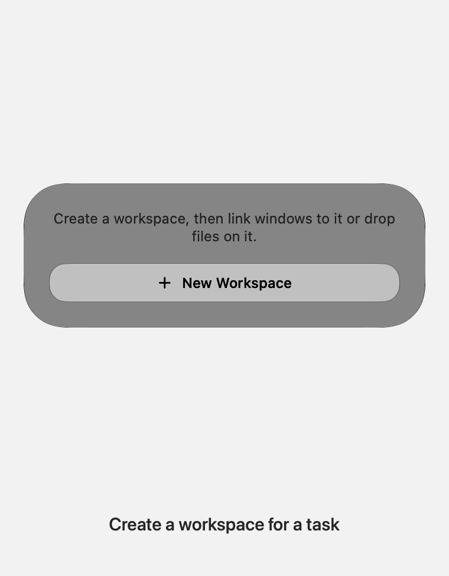

<p align="center"></p>

# Stacky

A menu bar workspace manager for macOS. Group the windows and files of one task into a workspace, fold them away with a click, and bring them back — on the same desktop or a different one.

Requires macOS 14 or later. Developed and tested on macOS 27.

<p align="center"></p>

## What it does

- **Workspaces.** A workspace is a named set of windows, files, folders, apps and links.
- **Fold and release.** Fold minimizes a workspace's windows. Release brings them back where they were, in the same stacking order, onto the desktop you are looking at. Fold on one desktop and release on another to move a whole task across.
- **Go to a workspace.** Click a workspace card to gather its windows on the desktop that already holds most of them, switch there, and open any linked file that has no window yet.
- **Recover from files.** Linking a window also links the file or folder it shows, so a workspace can reopen its documents after the apps have quit or the Mac has restarted.
- **Multiple monitors.** A workspace can span monitors; windows always return to their own monitor.

## Demos

Recorded in a clean virtual machine with made-up documents.

**Sort a messy set of desktops.** Two tasks' windows are scattered over three desktops. One click on each workspace gathers its windows onto a single desktop, leaving one task per desktop.

<p align="center"></p>

**Link windows by clicking them.** Create a workspace, turn on link mode, click each window, press Done. The files behind the windows are linked too.

<p align="center"></p>

**Move a workspace to another desktop.** Fold on Desktop 1, switch to Desktop 2, release: the windows arrive there in the same order.

<p align="center"></p>

**Reopen a workspace from its files.** After the apps have quit, clicking the workspace opens its linked documents again.

<p align="center"></p>

## Install

There are no prebuilt downloads yet, so Stacky is built on your Mac. It takes about a minute.

**You need** macOS 14 or later and Apple's command line tools. If you're not sure you have them, run `xcode-select --install`; it says so if they're already installed. Full Xcode works too.

**1. Build and install.** In Terminal:

```sh
git clone https://github.com/HinaShirosaki/Stacky.git
cd Stacky
scripts/install.sh
```

This builds Stacky, copies it to `/Applications` (or `~/Applications` if you can't write there), and opens it. The stacked-layers icon appears in the menu bar.

**2. Allow Accessibility.** Click the icon. A banner asks for Accessibility access and opens the right page in System Settings › Privacy & Security › Accessibility; turn Stacky on there. Stacky needs this to read, minimize, move and raise other apps' windows. It is not sandboxed and makes no network connections.

**3. Optional: start at login.** System Settings › General › Login Items › Open at Login › **+**, then choose Stacky.

### Update

```sh
cd Stacky
git pull
scripts/install.sh
```

Your workspaces are kept.

### Uninstall

Quit Stacky (right-click the list's background › Quit), then delete `Stacky.app` from Applications and the folder `~/Library/Application Support/Stacky`. Remove it from the Accessibility list in System Settings.

### Troubleshooting

- **No icon in the menu bar.** The menu bar may be full or hidden behind the notch. Quit another menu bar app, or ⌘-drag icons to make room. Stacky also opens its list as a window when its icon can't be seen.
- **Stacky asks for Accessibility again after every update.** The build is signed with your Developer ID or Apple Development certificate if you have one (any free Apple account in Xcode › Settings › Accounts gives you one). Without one it is signed ad-hoc, and macOS treats each build as a new app: switch Stacky off and on again in the Accessibility list.
- **`swift: command not found` or `xcrun: error`.** Run `xcode-select --install`, then `scripts/install.sh` again.

## Use

Click the Stacky icon in the menu bar.

<p align="center"></p>

| To | Do this |
|---|---|
| Create a workspace | **+ New Workspace**, type a name, press Return |
| Link windows | The cursor icon on a card, then click each window; Esc or **Done** to finish. Or pick from a list with the window icon |
| Link files, folders, apps | Drag them onto a card (dragging onto the menu bar icon opens the list), or use the paperclip |
| See or remove what is linked | The list icon on a card |
| Fold / release | The **Fold** / **Release** button on a card |
| Go to a workspace | Click the card |
| Delete a workspace | Right-click the card |
| Mark an app as shared | The gear button › **Shared Apps** |

The gear button (or a right-click on the list's background) also sets how folding works (minimize windows, or hide whole apps) and quits Stacky.

### What gets linked with a window

| App | Linked |
|---|---|
| VS Code, Cursor, Windsurf, VSCodium and other VS Code forks | The folder the window has open |
| Document apps that report their file (tested with Acrobat and ChemDraw; Preview, Office and other standard document apps should behave the same) | The document |
| Terminal | The working directory |
| Apps that report nothing (many Qt, Java and Electron apps) | A file named like the window title that the app can open, found with Spotlight |
| Any window with no file behind it (Calculator, Mail, a browser) | The app itself, so it can be relaunched |

The Spotlight rule is a best guess; if it picks the wrong file, remove it from the card's list. A relaunched app opens its own default window, not the exact window you had.

### Shared apps

Some apps serve every task: Mail, chat, music. Mark them under the gear button › **Shared Apps** and Stacky will:

- show their windows on every desktop, so they follow you;
- never fold or move them for one workspace, even if a window of theirs is linked to it.

The list offers the apps that are running. Unmarking an app puts its windows back on the desktop you are on.

## Limitations

- **Moving a window to another desktop moves its whole app.** For an app used by several workspaces, mark it as shared (above) so it is left alone. macOS no longer lets one app move another app's individual windows between desktops. Stacky uses the one call that still works, which moves every window of that app. Folding and releasing without changing desktop moves nothing.
- **Private system calls.** Desktop (Spaces) support uses undocumented macOS functions that Apple can change in any update. If they disappear, Stacky falls back to working on the current desktop only.
- **Not linked automatically:** JetBrains, Zed and Sublime project folders, Finder windows, browser tabs, and windows with no title.
- **Multiple monitors** are covered by automated tests but have not yet been run on real multi-monitor hardware.

## Development

```sh
swift test          # engine and matching logic, with mocked windows and desktops
scripts/bundle.sh   # build/Stacky.app
swift scripts/make-icon.swift   # regenerate the icon
scripts/make-demo.sh            # regenerate docs/walkthrough.gif from made-up workspaces
```

The code is split into small modules (`WindowKit`, `SpacesKit`, `LaunchKit`, `Store`, `AppUI`). [docs/INTERNALS.md](docs/INTERNALS.md) covers the architecture, the private calls and their risks, measurements, and the built-in diagnostics.

## License

[MIT](LICENSE)
